# 交通信号灯与交通标志

> **一句话考点**：交通信号 = **灯 + 标志 + 标线 + 交警手势**。本篇覆盖信号灯 9 类、标志分类与颜色形状规则、警告标志 45 个、禁令标志 39 个、指示标志 24 个。

---

## 一、交通信号灯（9 类）

| 类别 | 光信号 | 核心含义 |
|------|--------|---------|
| **机动车信号灯** | 无图案 | 红黄绿三色，指挥机动车通行 |
| **非机动车信号灯** | 有图案 | 指挥非机动车通行 |
| **左转非机动车信号灯** | 有图案 | 指挥左转非机动车 |
| **人行横道信号灯** | 有图案 | 红灯（行人站立）禁止进入；绿灯（行人行走）允许通过 |
| **车道信号灯** | 有图案 | 绿色箭头允许本车道通行；红色叉形/箭头禁止本车道通行 |
| **方向指示信号灯** | 有图案 | 箭头方向：左=左转、上=直行、右=右转 |
| **闪光警告信号灯** | 无图案 | 持续闪烁黄灯，提示注意瞭望、确认安全后通过 |
| **道口信号灯** | 无图案 | 两个红灯交替闪烁或一个红灯亮 = 火车即将通过，禁止通行 |
| **掉头信号灯** | 有图案 | 绿灯允许掉头（不得妨碍被放行车辆/行人）；红灯禁止掉头 |

**机动车/非机动车信号灯细则**：
- **绿灯**：准许直行或转弯；转弯车辆不得妨碍被放行的直行车辆和行人。
- **黄灯**：已越过停止线的车辆继续通行；未越过停止线的车辆停车等待，禁止进入路口，更禁止加速抢行。
- **红灯**：禁止直行或左转弯，不得越过停止线；在不妨碍被放行车辆、行人的情况下，**允许右转弯**。
- 未设非机动车信号灯和人行横道信号灯的路口，非机动车和行人按机动车信号灯通行。

> 🧪 自测：[交通信号灯](99_科目一自测题.md#05)

---

## 二、交通标志基础

### 1. 分类

| 层级           | 内容                     |
| ------------ | ---------------------- |
| **主标志**（7 种） | 警告、禁令、指示、指路、旅游区、作业区、告示 |
| **辅助标志**     | 附设在主标志下，起辅助说明作用        |

### 2. 颜色含义（速查）

| 颜色 | 含义 |
|------|------|
| **红色** | 禁止、停止、危险（禁令标志边框/底色/斜杠） |
| **黄色 / 荧光黄** | 警告（警告标志底色） |
| **蓝色** | 指令、遵循（指示标志底色）；一般道路指路标志 |
| **绿色** | 地名、路线、方向（高速公路/城市快速路指路标志） |
| **棕色** | 旅游区及景点 |
| **黑色** | 文本、图形符号、部分边框 |
| **白色** | 底色、文本、图形符号、部分边框 |
| **橙色 / 荧光橙** | 道路作业区 |
| **荧光黄绿色** | 警告（注意行人、注意儿童） |

### 3. 形状规则（速查）

| 形状 | 用途 |
|------|------|
| **正等边三角形（顶角朝上）** | 警告标志 |
| **圆形** | 禁令标志、指示标志 |
| **倒等边三角形** | 减速让行 |
| **八角形** | 停车让行 |
| **叉形** | 铁路平交道口叉形符号 |
| **方形** | 指路、部分警告/禁令/指示、旅游区、辅助、告示 |

> 🧪 自测：[交通标志基础](99_科目一自测题.md#05)

---

## 三、警告标志（45 个）

**常用警告标志图例**

| 图例 | 名称 | 图例 | 名称 | 图例 | 名称 |
| :---:|:--- | :---:|:--- | :---:|:--- |
| 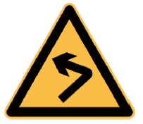 | 向左急弯路 | 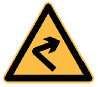 | 向右急弯路 | 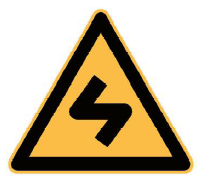 | 反向弯路 |
| 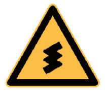 | 连续弯路 | 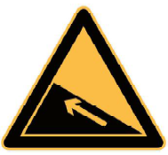 | 上陡坡 | 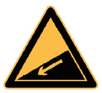 | 下陡坡 |
| 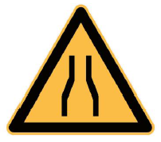 | 两侧变窄 | 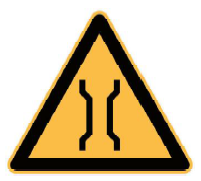 | 窄桥 | 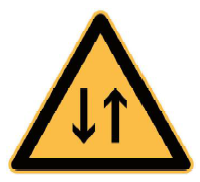 | 双向交通 |
| 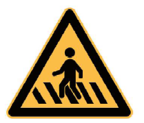 | 注意行人 | 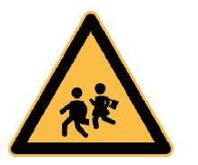 | 注意儿童 | 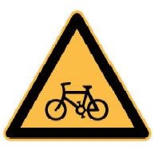 | 注意非机动车 |
| 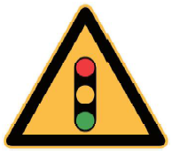 | 注意信号灯 | 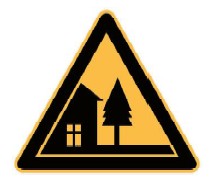 | 村庄 | 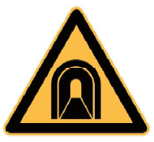 | 隧道 |
| 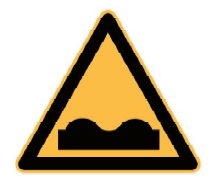 | 路面不平 | 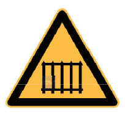 | 有人看守铁路道口 | 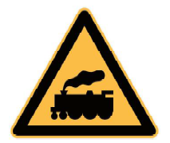 | 无人看守铁路道口 |
| 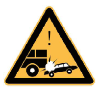 | 事故易发路段 | 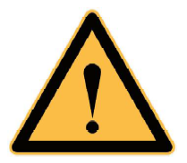 | 注意危险 | 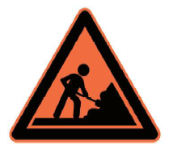 | 施工 |
| 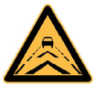 | 注意保持车距 | 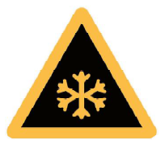 | 注意路面结冰 | 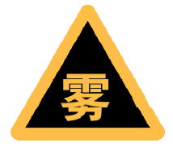 | 注意雾天 |

> 颜色：**黄底、黑边、黑图形**（注意信号灯等个别除外）；形状：等边三角形或矩形。

### 3.1 交叉路口类
| 编号 | 标志 | 含义 |
|------|------|------|
| 1 | 十字交叉路口 | 前方有十字交叉路口，谨慎慢行 |
| 2 | T 型交叉路口 | 前方有 T 型交叉路口 |
| 3 | 环形交叉路口 | 前方有环形交叉路口 |
| 4 | Y 型交叉路口 | 前方有 Y 型交叉路口 |

### 3.2 弯道与坡道类
| 编号 | 标志 | 含义 |
|------|------|------|
| 5 | 向左急转弯 | 前方向左急转弯，减速慢行 |
| 6 | 向右急转弯 | 前方向右急转弯，减速慢行 |
| 7 | 反向弯路 | 前方有两个方向相反的急弯路 |
| 8 | 连续弯路 | 前方有三个或以上方向相反的急弯路 |
| 9 | 上陡坡 | 前方有上陡坡路段 |
| 10 | 下陡坡 | 前方有下陡坡路段 |
| 11 | 连续下坡 | 前方有两个及以上连续下坡路段 |

### 3.3 路况危险类
| 编号 | 标志 | 含义 |
|------|------|------|
| 12 | 事故易发路段 | 前方为交通事故易发路段 |
| 13 | 注意危险 | 前方有其他标志不能包括的危险路段 |
| 14 | 窄路 | 双车道路面宽度缩减至 6 米以下 |
| 15 | 窄桥 | 桥面净宽小于 6 米 |
| 16 | 易滑 | 前方道路较滑，易发生事故 |
| 17 | 注意落石 | 前方有落石危险的傍山路段 |
| 18 | 傍山险路 | 前方是傍山险路 |
| 19 | 堤坝路 | 前方有水库、湖泊、河流等堤坝道路 |
| 20 | 村庄 | 前方紧靠村庄、集镇且视线不良 |
| 21 | 隧道 | 前方是双向行驶且照明不好的隧道 |
| 22 | 隧道开车灯 | 前方是无照明或照明不足的隧道，应开前照灯 |
| 23 | 驼峰桥 | 前方是拱度很大、影响视距的驼峰桥 |
| 24 | 路面不平 | 前方路面颠簸或桥头跳车严重 |
| 25 | 路面高突 | 前方路面突然高突 |
| 26 | 路面低洼 | 前方路面突然低洼 |
| 27 | 过水路面 / 漫水桥 | 前方有过水路面或漫水桥，应停车查明水情 |
| 28 | 慢行 | 前方发生特殊情况，影响行车安全 |
| 29 | 施工 | 前方道路施工，减速慢行或绕道 |

### 3.4 注意人员/动物类
| 含义             | 编号  | 标志     |
| -------------- | --- | ------ |
| 前方设有人行横道线，注意行人 | 30  | 注意行人   |
| 前方是儿童频繁出入地点    | 31  | 注意儿童   |
| 前方经常有非机动车横穿、出入 | 32  | 注意非机动车 |
| 前方是残疾人频繁出入地点   | 33  | 注意残疾人  |
| 前方常有牲畜横穿、出入    | 34  | 注意牲畜   |
| 前方常有野生动物横穿、出入  | 35  | 注意野生动物 |

### 3.5 特殊环境类
| 编号 | 标志 | 含义 |
|------|------|------|
| 36 | 注意横风 | 前方有很强的侧向风 |
| 37 | 注意信号灯 | 前方有不易发现的信号灯路口 |
| 38 | 双向交通 | 前方是不分离的双向行驶路段，注意会车 |
| 39 | 注意潮汐车道 | 前方车道行驶方向随交通管理需要变化 |
| 40 | 注意保持车距 | 前方经常发生追尾事故，保持安全距离 |
| 41 | 注意分离式道路 | 前方平面交叉的被交道路是分离式道路 |
| 42 | 注意前方车辆排队 | 前方车辆排队 |
| 43 | 注意路面结冰 / 雨雪天 / 雾天 / 不利气象 | 注意不利气象条件，谨慎驾驶 |
| 44 | 建议速度 | 以建议速度行驶（常与其他警告标志联用） |
| 45 | 避险车道 | 前方设有避险车道，供失控车辆安全减速 |

### 3.6 铁路道口专项
| 标志 | 含义 |
|------|------|
| 有人看守铁路道口 | 减速或停车观察，按信号灯或管理人员指挥通行 |
| 无人看守铁路道口 | 减速或停车观察，确认安全后通行 |
| 叉形符号 | 表示有多股铁路与道路相交（设在道口标志上方） |
| 斜杠符号 | 红色斜杠表示距无人看守道口的距离，**一条斜杠 = 50 米** |

> 🧪 自测：[警告标志](99_科目一自测题.md#05)

---

## 四、禁令标志（39 个）

**常用禁令标志图例**

| 图例 | 名称 | 图例 | 名称 | 图例 | 名称 |
| :---:|:--- | :---:|:--- | :---:|:--- |
| 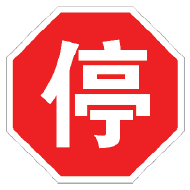 | 停车让行 | 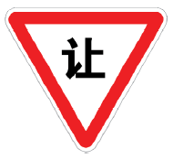 | 减速让行 | 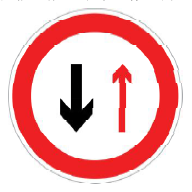 | 会车让行 |
| 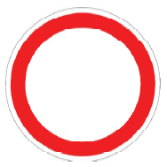 | 禁止通行 | 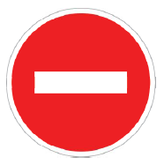 | 禁止驶入 | 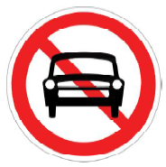 | 禁止机动车驶入 |
| 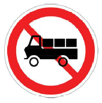 | 禁止载货汽车驶入 | 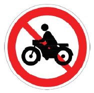 | 禁止摩托车驶入 | 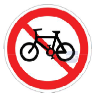 | 禁止非机动车进入 |
| 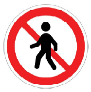 | 禁止行人进入 | 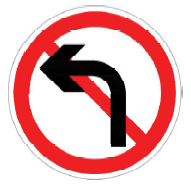 | 禁止向左转弯 | 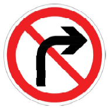 | 禁止向右转弯 |
| 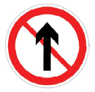 | 禁止直行 | 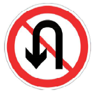 | 禁止掉头 | 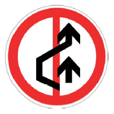 | 禁止超车 |
| 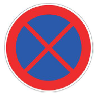 | 禁止车辆停放 | 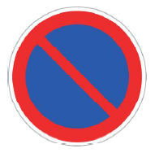 | 禁止车辆长时停放 | 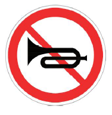 | 禁止鸣喇叭 |
| 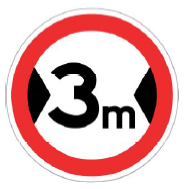 | 限制宽度 | 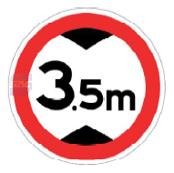 | 限制高度 | 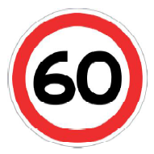 | 限制速度 |

> 颜色：**白底、红圈、红杠、黑图形**（个别除外）；形状：**圆形**。

### 4.1 让行类
| 标志   | 形状/颜色        | 含义                  |
| ---- | ------------ | ------------------- |
| 停车让行 | 八角形，红底白字     | 必须在停止线前停车瞭望，确认安全后通行 |
| 减速让行 | 倒三角形，白底红边黑字  | 减速或停车，让干道车辆优先       |
| 会车让行 | 圆形，白底红圈，红黑箭头 | 会车时必须停车让对方先行        |
|      |              |                     |

### 4.2 禁止通行/驶入类
| 标志 | 含义 |
|------|------|
| 禁止通行 | 禁止一切车辆和行人通行 |
| 禁止驶入 | 禁止一切车辆驶入（红底白横杠） |
| 停车检查 | 机动车必须停车接受检查 |
| 海关 | 前方是海关，必须停车接受检查 |

### 4.3 禁止停车类
| 标志 | 含义 |
|------|------|
| 禁止停车 | 限定范围内禁止一切车辆停放（红圈红叉） |
| 禁止长时停车 | 禁止长时间停放，**临时停车不受限制**（红圈红斜杠） |

### 4.4 禁止特定车辆驶入类
禁止机动车、载货汽车、电动三轮车、大型/小型客车、挂车/半挂车、拖拉机、三轮汽车/低速货车、摩托车、某两种车辆、非机动车、畜力车、人力客/三轮车、人力车、行人进入。

### 4.5 禁止转向/掉头/鸣喇叭类
| 标志        | 含义            |
| --------- | ------------- |
| 禁止向左/向右转弯 | 禁止一切车辆向左/向右转弯 |
| 禁止直行      | 禁止一切车辆直行      |
| 禁止向左向右转弯  | 禁止一切车辆向左向右转弯  |
| 禁止掉头      | 禁止机动车掉头       |
| 禁止鸣喇叭     | 禁止车辆鸣喇叭       |

### 4.6 限制类
| 标志     | 含义                |     |
| ------ | ----------------- | --- |
| 限制宽度   | 禁止装载宽度超过标志数值的车辆通行 |     |
| 限制高度   | 禁止装载高度超过标志数值的车辆通行 |     |
| 限制质量   | 禁止总质量超过标志数值的车辆通行  |     |
| 限制轴重   | 禁止轴重超过标志数值的车辆通行   |     |
| 禁止超车   | 禁止超车              |     |
| 解除禁止超车 | 禁止超车路段结束          |     |
| 限制速度   | 限制最高车速            |     |
| 解除限制速度 | 限制速度结束            |     |

### 4.7 区域与其他
| 标志           | 含义                         |
| ------------ | -------------------------- |
| 区域禁止及解除      | 区域内禁止某种行为（限速、禁止长时停车、禁止停车等） |
| 禁止运输危险物品车辆驶入 | 禁止运输危险物品的车辆驶入              |

> 🧪 自测：[禁令标志](99_科目一自测题.md#05)

---

## 五、指示标志（24 个）

**常用指示标志图例**

| 图例 | 名称 | 图例 | 名称 | 图例 | 名称 |
| :---:|:--- | :---:|:--- | :---:|:--- |
| 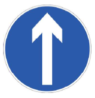 | 直行 | 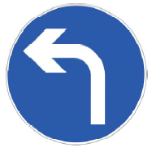 | 向左转弯 | 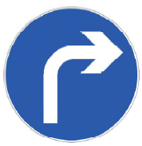 | 向右转弯 |
| 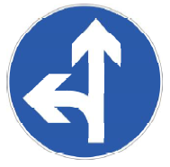 | 直行和向左转弯 | 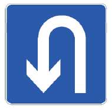 | 允许掉头 |  | 环岛行驶 |
|  | 最低限速 |  | 会车先行 |  | 单行路（直行） |
|  | 人行横道 |  | 多乘员车辆（HOV）专用车道 |  | 公交专用车道 |
|  | 非机动车车道 |  | 机动车行驶 |  | 非机动车行驶 |
|  | 靠右侧车道行驶 |  | 停车位 |  |  |

> 颜色：**蓝底、白图形**；形状：圆形、长方形、正方形。

| 编号  | 标志              | 含义                                          |
| --- | --------------- | ------------------------------------------- |
| 1   | 直行              | 一切车辆准许直行                                    |
| 2   | 向左/向右转弯         | 一切车辆准许向左/向右转弯                               |
| 3   | 直行和向左/向右转弯      | 准许直行并左/右转弯                                  |
| 4   | 向左和向右转弯         | 准许向左和向右转弯                                   |
| 5   | 靠右侧/靠左侧道路行驶     | 车辆应靠右/靠左行驶                                  |
| 6   | 立体交叉行驶路线        | 按图示路线在立交处左/右转                               |
| 7   | 环岛行驶            | 靠右环行，环内车辆优先                                 |
| 8   | 单行路             | 单向行驶道路                                      |
| 9   | 步行              | 只供步行，任何车辆不准进入                               |
| 10  | 鸣喇叭             | 行至该处鸣喇叭，提醒对向车辆                              |
| 11  | 最低限速            | 驶入前方道路的最低时速限制                               |
| 12  | 路口优先通行          | 主要道路车辆享有优先通行权                               |
| 13  | 会车先行            | 会车时享有优先通行权（蓝底，红箭头对向，白箭头优先）                  |
| 14  | 人行横道            | 该处为人行横道（蓝底，白三角形，黑图形）                        |
| 15  | 车道行驶方向          | 按车道标志指示方向行驶                                 |
| 16  | 允许掉头            | 该处允许机动车掉头                                   |
| 17  | 多成员车辆（HOV）专用车道  | 仅供指定多成员车辆通行                                 |
| 18  | 公交线路专用车道        | 专供本线路公交车辆行驶                                 |
| 19  | 快速公交系统（BRT）专用车道 | 专供 BRT 车辆行驶                                 |
| 20  | 机动车行驶           | 前方道路只供机动车行驶                                 |
| 21  | 机动车车道           | 所示车道只供机动车行驶                                 |
| 22  | 非机动车行驶          | 前方道路只供非机动车行驶                                |
| 23  | 非机动车车道          | 所示车道只供非机动车行驶                                |
| 24  | 停车位标志           | 允许停放的区域（含限时段、限时长、残疾人、校车、出租车、非机动车、公交车、专属停车位） |

> 🧪 自测：[指示标志](99_科目一自测题.md#05)

---

## 六、速记口诀

| 主题 | 口诀 |
|------|------|
| 警告标志 | **黄底黑边黑图形，三角顶角朝上** |
| 禁令标志 | **白底红圈红杠黑图形，圆形为主** |
| 指示标志 | **蓝底白图形，圆形/方形** |
| 指路标志 | **一般道路蓝底，高速绿底** |
| 旅游区 | **棕底白字** |
| 作业区 | **橙底黑图形** |
| 形状 | **三角警告、圆禁令指示、倒三减速、八角停车、叉形铁路、方形指路** |

---

## 七、易混对比

| 易混点            | 区分                                             |
| -------------- | ---------------------------------------------- |
| 禁止停车 vs 禁止长时停车 | **红圈红叉** = 完全不能停；**红圈红斜杠** = 可临时停车             |
| 禁止通行 vs 禁止驶入   | 禁止通行 = 车辆和行人都不能过；禁止驶入 = 只禁止车辆驶入（红底白横杠）         |
| 停车让行 vs 减速让行   | 停车让行 = **八角形红底**，必须停车；减速让行 = **倒三角白底红边**，减速或停车 |
| 会车让行 vs 会车先行   | 让行 = 红圈红黑箭头，须停车让对方；先行 = 蓝底白箭头，享有优先权            |
| 警告 vs 禁令 vs 指示 | 警告 = 黄底三角；禁令 = 白底红圈圆；指示 = 蓝底白图形                |
| 指路标志颜色         | 一般道路 = 蓝底；高速/城市快速路 = 绿底                        |
| 铁路道口斜杠         | 一条斜杠 = **50 米**                                |

---

