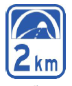
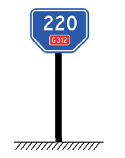
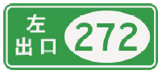
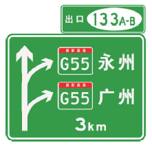
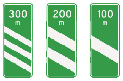
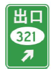
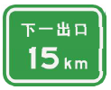
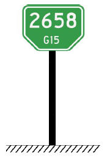
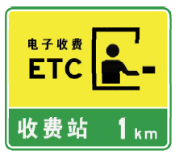
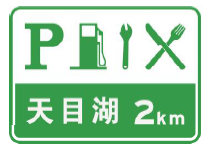

# 指路标志·标线与交警手势

> **一句话考点**：指路标志**一般道路蓝底、高速绿底**；标线分禁止/指示/警告三类；路口有交警指挥时，**以交警手势为准**。

---

## 一、指路标志总览

**常用指路标志图例**

| 图例 | 名称 | 图例 | 名称 | 图例 | 名称 |
| :---:|:--- | :---:|:--- | :---:|:--- |
|  | 地名 |  | 隧道出口距离 |  | 里程碑 |
|  | 出口编号 |  | 出口预告标志及出口方向 |  | 300m、200m、100m出口预告 |
|  | 出口 |  | 下一出口预告 |  | 里程牌 |
|  | 收费站预告及收费站 |  | 服务区预告 |  |  |

| 项目 | 规定 |
|------|------|
| 作用 | 指引道路信息，提供目的地、沿途城镇、公共设施、服务设施、地点、距离和行车方向 |
| 一般道路颜色 | **蓝底、白图形、白边框、蓝色衬边** |
| 高速/城市快速路颜色 | **绿底、白图形、白边框、绿色衬边** |
| 形状 | 长方形、正方形 |

> 🧪 自测：[指路标志总览](99_科目一自测题.md#06)

---

## 二、普通道路指路标志

| 编号  | 标志            | 设置位置                           | 作用                           |
| --- | ------------- | ------------------------------ | ---------------------------- |
| 1   | 交叉路口预告标志      | 路口前 150–500 米                  | 预告前方路口形式、道路编号/名称、方向、距离       |
| 2   | 交叉路口告知标志      | 路口前 30–80 米                    | 告知前方路口形式、道路编号/名称、方向          |
| 3   | 确认标志          | 路口后 30–50 米等                   | 确认当前道路信息（公路编号、街道名称、路名牌、地点距离） |
| 4   | 地名标志          | 沿途市、县、镇、村边缘                    | 指示前方经过的行政区划                  |
| 5   | 著名地点标志        | 著名桥梁、隧道、重要垭口等                  | 指示前方著名地点                     |
| 6   | 分界标志          | 行政区划分界处/道路养护分界处                | 指示当前处于分界处                    |
| 7   | 地点识别标志        | 重要场所前                          | 识别急救站、机场等多个重要场所              |
| 8   | 停车场（区）标志      | 停车场入口附近                        | 指示附近有停车场                     |
| 9   | 错车道标志         | 距错车道 100–150 米                 | 指示前方设有错车道                    |
| 10  | 残疾人专用设施标志     | 残疾人设施附近                        | 指示设施位置                       |
| 11  | 人行天桥 / 地下通道标志 | 入口附近                           | 指引行人通往天桥/地下通道                |
| 12  | 应急避难设施标志      | 应急避难场所、隧道疏散通道附近                | 指示应急避难设施                     |
| 13  | 观景台标志         | 路侧可供停车观景地带                     | 指示前方有观景台                     |
| 14  | 休息区标志         | 路侧休息区两侧                        | 指示前方有休息区                     |
| 15  | 绕行标志          | 实施交通管制路口前                      | 指示车辆按路线绕行                    |
| 16  | 死路不通标志        | 不能通行道路前                        | 表示前方道路无出口                    |
| 17  | 交通监控设备标志      | 设置监控设备路段                       | 表示前方有图像采集等监控                 |
| 18  | 车道数增加标志       | 车道增加段前                         | 提示前方车道数增加                    |
| 19  | 车道数变少标志       | 变化点前                           | 提示前方车道数变少                    |
| 20  | 隧道出口距离预告标志    | 特长隧道内（>3km），距出口 2km 起每 500 米一块 | 指示到隧道出口的距离                   |
| 21  | 线形诱导标         | 弯道、小半径曲线外侧、视距不良 T 形路口等         | 引导行车方向                       |
| 22  | 入口预告标志        | 进入高速/城市快速路前的被交道路               | 预告入口距离及方向                    |
| 23  | 地点方向标志        | 驶入高速/快速路的匝道分叉点                 | 指示两个行驶方向                     |

**公路编号标志颜色**：

| 道路等级 | 颜色 |
|---------|------|
| 国道 | 红底、白字、白边框、红色衬边 |
| 省道 | 黄底、黑字、黑边框、黄色衬边 |
| 县道 | 白底、黑字、黑边框、白色衬边 |
| 乡道 | 白底、黑字、黑边框、白色衬边 |

> 🧪 自测：[普通道路指路标志](99_科目一自测题.md#06)

---

## 三、高速公路 / 城市快速路指路标志

| 编号  | 标志            | 设置位置                       | 作用                       |
| --- | ------------- | -------------------------- | ------------------------ |
| 24  | 编号标志          | 指路标志版面中                    | 指示高速公路编号（国家/省级）          |
| 25  | 命名编号标志        | 互通立交加速车道渐变段终点后             | 指示高速名称与编号                |
| 26  | 地点距离标志        | 互通立交加速车道渐变段终点后 1000 米以上    | 指示前方重要地点、道路名称和距离（三行由近及远） |
| 27  | 路名标志          | 无统一编号的高速/快速路               | 指示道路名称                   |
| 28  | 出口编号标志        | 出口预告标志顶角（左上/右上）            | 标识出口编号，不单独设置             |
| 29  | 下一出口预告标志      | 互通立交间距 3–5 公里时             | 预告下一出口信息和距离              |
| 30  | 出口预告标志        | 距减速车道起点 2km/1km/500m/起点    | 预告出口距离、编号、方向             |
| 31  | 里程牌           | 高速两侧或中央分隔带                 | 指示里程、公路编号或名称             |
| 32  | 百米牌           | 高速两侧各里程牌之间，每 100 米一块       | 指示百米位置                   |
| 33  | 车距确认标志        | 互通立交间距 >10km 且无其他指路标志的平直路段 | 帮助确认与前车距离                |
| 34  | 出口标志及出口地点方向标志 | 指出匝道三角带端部                  | 指示出口及编号                  |
| 35  | 高速公路起点标志      | 高速/快速路起点                   | 指示起点                     |
| 36  | 终点预告标志        | 距终点 2km/1km/500m           | 预告终点                     |
| 37  | 终点提示标志        | 距终点 200 米附近                | 提示即将进入普通公路（黄底黑边黑字）       |
| 38  | 终点标志          | 高速/快速路终点                   | 指示终点                     |
| 39  | 特殊天气建议速度标志    | 雨雪雾等特殊天气路段                 | 根据可见车距确认线数量确定建议速度        |
| 40  | 救援电话标志        | 高速公路                       | 指示救援电话号码                 |
| 41  | 紧急电话标志        | 紧急电话处                      | 指示紧急电话位置                 |
| 42  | 电话位置指示标志      | 各紧急电话之间                    | 指示最近紧急电话方向及距离            |
| 43  | 加油站标志         | 通往加油站入口附近                  | 指示加油站位置                  |
| 44  | 紧急停车带标志       | 紧急停车带前端                    | 指示紧急停车位置                 |
| 45  | 交通信息标志        | 高速/快速路适当地点                 | 指示交通信息广播频率               |
| 46  | 计重收费标志        | 计重收费收费站前                   | 指示前方采用计重收费               |
| 47  | 停车领卡标志        | 收费站入口一侧                    | 提示停车领卡                   |
| 48  | 收费站预告及收费站标志   | 距收费广场渐变段起点 2km/1km/500m/起点 | 预告收费站距离和收费方式             |
| 49  | ETC 车道指示标志    | 收费广场渐变段起点前 300 米           | 指示 ETC 车道（黄色箭头为 ETC 方向）  |
| 50  | 方向标志          | 指路标志版面中或版面外                | 指示东、南、西、北方向              |
| 51  | 服务区预告标志       | 距服务区 2km/1km/减速车道起点/入口     | 预告服务区位置和服务内容             |
| 52  | 停车场预告标志       | 距停车场 1km/减速车道起点/入口         | 预告停车场距离和位置               |
| 54  | 停车场标志         | 停车场前                       | 告知此处有停车场（露天/室内）          |
| 55  | 爬坡车道标志        | 爬坡车道前后                     | 指示最右侧车道为大型重载车辆爬坡专用       |
| 56  | 超限检测站标志       | 超限超载检测站前                   | 预告前方超限检测站                |

> 🧪 自测：[高速与快速路指路标志](99_科目一自测题.md#06)

---

## 四、旅游区标志

| 项目      | 规定                       |
| ------- | ------------------------ |
| 颜色/形状   | **棕底、白字/图形、白边框、棕色衬边**；矩形 |
| 旅游区距离标志 | 告知旅游区名称、代表图形及距离          |
| 旅游区方向标志 | 告知旅游区名称、代表图形及方向          |
| 旅游符号    | 告知旅游项目类别、指引及代表符号         |

> 🧪 自测：[旅游区标志](99_科目一自测题.md#06)

---

## 五、作业区标志

| 项目          | 规定                            |
| ----------- | ----------------------------- |
| 颜色          | **橙底、黑图形**（指路标志可加橙色绕行箭头）      |
| 作用          | 通告道路施工、养护路段的阻断、绕行情况           |
| 作业区距离标志     | 设于警告区起点，预告距作业区的长度             |
| 作业区长度标志     | 设于缓冲区起点，预告作业路段长度              |
| 作业区结束标志     | 设于中止区之后，说明作业区结束位置             |
| 车道数变少标志     | 设于警告区中点附近                     |
| 改道标志        | 设于警告区中点附近，指示借用对向车道或改道         |
| 橙色箭头标志      | 附于绕行路线原有指路标志上，指示绕行方向          |
| 绕行标志        | 设于作业封闭路段前方交叉口，黑色箭头表示绕行路线      |
| 线形诱导标       | 引导作业区行车方向                     |
| 注意交通引导人员标志  | 设于引导人员前至少 100 米               |
| 行人、非机动车通道标志 | 指示临时绕行通道                      |
| 移动性作业标志     | 悬挂于工程车后部或移动作业区前方（橙底黑图，背面两面彩旗） |

> 🧪 自测：[作业区标志](99_科目一自测题.md#06)

---

## 六、交通标线

### 6.1 禁止与指示标线

| 标线         | 颜色           | 含义                       |
| ---------- | ------------ | ------------------------ |
| 减速让行线      | 白色           | 两条平行虚线 + 倒三角形，设在减速让行标志路口 |
| 网状线        | 黄色           | 严格禁止一切车辆以任何原因停车          |
| 非机动车道线     | —            | 该车道为非机动车道，机动车不得进入        |
| 小型车专用车道线   | —            | 该车道为小型车专用                |
| 大型车道线      | —            | 大型车应在该车道行驶               |
| 公交专用车道线    | 黄虚线 + 白文本    | 除公交车外，其他车辆及行人不得进入        |
| 多成员车辆专用车道线 | 白虚线 + 白文本    | 仅多成员车辆专用                 |
| 禁止掉头/转弯标记  | 黄色导向箭头 + 黄叉形 | 本路口/区间禁止掉头或转弯            |

### 6.2 警告标线

| 标线           | 颜色     | 含义                   |
| ------------ | ------ | -------------------- |
| 三车道变双车道渐变段标线 | 黄色     | 警告路宽/车道数变化，谨慎行车，禁止超车 |
| 接近障碍物标线      | 黄色     | 指示路面有固定障碍物，引导驶离      |
| 收费岛地面标线      | 白色     | 标示收费车道位置             |
| 铁路平交道口标线     | —      | 指示前方有铁路道口，应在停车线处停车   |
| 地面标记         | 黄黑相间   | 提醒注意高出路面的构造物         |
| 收费广场减速标线     | 白色反光虚线 | 警告前方收费广场，减速慢行        |
| 车行道减速标线      | 白色     | 警告本车道需减速（横向/纵向）      |
| 轮廓标          | —      | 指示道路前进方向和边缘轮廓        |

> 🧪 自测：[交通标线](99_科目一自测题.md#06)

---

## 七、交通警察手势信号（8 种）

> **通行优先级**：有交警指挥的路口，必须**按交警指挥通行**（高于信号灯、标志、标线）。

| 手势          | 动作要点                           | 含义                  |
| ----------- | ------------------------------ | ------------------- |
| **停止信号**    | 左臂向前上方直伸，掌心向前                  | 交警面向的车辆不准通行         |
| **靠边停车信号**  | 右臂前下方、掌心向左；左臂前上方、掌心向前；右臂向左水平摆动 | 面向车辆按指示靠边停车         |
| **直行信号**    | 左臂向左平伸、掌心向前；右臂向右平伸、掌心向前，向左摆动   | 准许交警右侧直行车辆通行        |
| **变道信号**    | 右臂向前平伸、掌心向左；右臂向左水平摆动           | 面向车辆由正在行驶的车道变道，减速慢行 |
| **左转弯信号**   | 右臂向前平伸、掌心向前；左臂与手掌平直向右前方摆动、掌心向右 | 准许面向车辆左转弯，不妨碍时可掉头   |
| **右转弯信号**   | 左臂向前平伸、掌心向前；右臂与手掌平直向左前方摆动、掌心向左 | 准许面向车辆右转弯           |
| **左转弯待转信号** | 左臂向左下方平伸、掌心向下；左臂与手掌平直向下方摆动     | 准许左侧左转车辆进入路口，等候左转信号 |
| **减速慢行信号**  | 右臂向右前方平伸、掌心向下；右臂与手掌平直向下方摆动     | 交警右侧车辆应减速慢行         |

> 🧪 自测：[交警手势](99_科目一自测题.md#06)

---

## 八、速记口诀

| 主题 | 口诀 |
|------|------|
| 指路标志颜色 | **一般道路蓝，高速公路绿** |
| 旅游区 | **棕底白字** |
| 作业区 | **橙底黑图** |
| 公路编号 | **国红、省黄、县白、乡白** |
| 标线颜色 | **黄线多禁止/警告，白线多指示** |
| 交警手势 | **停止左臂上举，直行双臂平伸，转弯单臂摆动** |

---

## 九、易混对比

| 易混点 | 区分 |
|--------|------|
| 交叉路口预告 vs 告知 | 预告 = 路口前 **150–500 米**；告知 = 路口前 **30–80 米** |
| 一般道路 vs 高速指路标志 | 一般道路 **蓝底**；高速/城市快速路 **绿底** |
| 旅游区 vs 作业区 | 旅游区 **棕底白字**；作业区 **橙底黑图** |
| 公路编号颜色 | 国道 **红**、省道 **黄**、县道/乡道 **白** |
| 网状线 vs 普通黄线 | 网状线内**任何原因都禁止停车** |
| 交警指挥 vs 信号灯 | 有交警指挥时，**以交警为准** |

---

