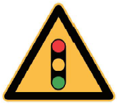
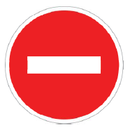
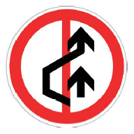
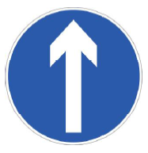
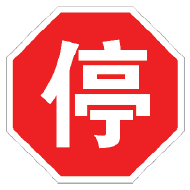

# 科目一自测题

> 点击每道题下方的「查看答案」展开解析。每篇开头有返回链接，可回到对应的笔记。

---

## 01 驾驶证申领·使用与审验

> 📖 返回：[01_驾驶证申领·使用与审验](01_驾驶证申领·使用与审验.md)

1. **情境决策**：小李刚取得 C1 驾驶证，处于实习期，想独自驾驶机动车上高速公路。下列说法正确的是？
    - A. 可以单独上高速
    - B. 应由持相应或更高准驾车型驾驶证 3 年以上的驾驶人陪同
    - C. 只要白天就可以上高速
    - D. 车身后部贴实习标志即可上高速
   

查看答案
✅ <strong>B</strong>。实习期内驾驶机动车上高速公路，应由持相应或更高准驾车型驾驶证 3 年以上的驾驶人陪同。

2. **条件推理**：小李持 C1 驾驶证，想驾驶一辆轻型牵引挂车（拖挂式房车）。他需要？
    - A. 直接驾驶即可
    - B. 增驾 C6
    - C. 换领 A2
    - D. 不需要任何条件
   

查看答案
✅ <strong>B</strong>。轻型牵引挂车对应 C6 驾驶证，需增驾取得。

3. **辨析纠错**：下列关于驾驶证有效期的说法，错误的是？
    - A. 初次申领的驾驶证有效期为 6 年
    - B. 6 年内每个记分周期未记满 12 分，换发 10 年有效期
    - C. 10 年内每个记分周期未记满 12 分，换发长期有效
    - D. 驾驶证有效期一经确定，不能变更
   

查看答案
✅ <strong>D</strong>。驾驶证有效期会按记分情况换发（6 年 → 10 年 → 长期）。

4. **条件推理**：王某持 A2 驾驶证，能否驾驶大型客车？
    - A. 可以，A2 包含大型客车
    - B. 不可以，需增驾 A1
    - C. 可以，但仅限白天
    - D. 可以，需 3 年以上驾龄
   

查看答案
✅ <strong>B</strong>。A2 为准驾重型牵引挂车，大型客车需 A1。

5. **情境决策**：驾驶证被暂扣期间，驾驶人能否驾驶机动车？
    - A. 可以短距离驾驶
    - B. 不可以，属于违法行为
    - C. 可以，只要不被查到
    - D. 可以，需携带暂扣凭证
   

查看答案
✅ <strong>B</strong>。驾驶证被暂扣期间驾驶机动车属于违法行为。

6. **流程顺序**：驾驶证遗失后补领，正确的顺序是？
   ① 向核发地或核发地以外车管所申请
   ② 提交身份证明
   ③ 车管所 1 日内补发
    - A. ①②③　B. ②①③　C. ③①②　D. ①③②
   

查看答案
✅ <strong>A</strong>。先申请、再提交身份证明、最后车管所 1 日内补发。

---

## 02 车辆登记·检验·保险·事故

> 📖 返回：[02_车辆登记·检验·保险·事故](02_车辆登记·检验·保险·事故.md)

1. **条件推理**：一辆小型非营运载客汽车，注册登记已满 8 年，其检验周期是？
    - A. 每 6 个月 1 次
    - B. 每年 1 次
    - C. 每 2 年 1 次
    - D. 每 3 年 1 次
   

查看答案
✅ <strong>B</strong>。小型非营运载客汽车 6 年内每 2 年 1 次，超过 6 年每年 1 次，超过 15 年每 6 个月 1 次。

2. **情境决策**：机动车所有权转让后，现车主应在多长时间内申请转让登记？
    - A. 10 日内
    - B. 30 日内
    - C. 60 日内
    - D. 90 日内
   

查看答案
✅ <strong>B</strong>。自机动车交付之日起 30 日内申请转让登记。

3. **辨析纠错**：下列关于交强险的说法，错误的是？
    - A. 未投保交强险的机动车不予登记
    - B. 交强险保险期间一般为 1 年
    - C. 交强险可以自愿选择是否投保
    - D. 保险标志应放置于被保险机动车上
   

查看答案
✅ <strong>C</strong>。交强险是国家强制保险，必须投保。

4. **流程顺序**：在普通公路发生交通事故，车辆妨碍交通且难以移动，正确的处置顺序是？
   ① 开启危险报警闪光灯
   ② 在车后 50–100 米设置警告标志
   ③ 组织车上人员疏散到路外安全地点
   ④ 报警
    - A. ①②③④　B. ②①③④　C. ①③②④　D. ③①②④
   

查看答案
✅ <strong>A</strong>。先开双闪、再设警告标志、然后疏散人员、最后报警。

5. **情境决策**：发生交通事故后逃逸，尚不构成犯罪的，处罚是？
    - A. 仅警告
    - B. 200 元以上 2000 元以下罚款
    - C. 吊销驾驶证且终生不得重新取得
    - D. 仅扣留车辆
   

查看答案
✅ <strong>B</strong>。逃逸尚不构成犯罪的，处 200–2000 元罚款；构成犯罪或致人死亡的另有更重处罚。

6. **条件推理**：小型非营运载客汽车行驶多少万千米时，国家引导报废？
    - A. 30 万千米　B. 50 万千米　C. 60 万千米　D. 80 万千米
   

查看答案
✅ <strong>C. 60 万千米</strong>。中型非营运载客汽车为 50 万千米。

---

## 03 违法记分规则

> 📖 返回：[03_违法记分规则](03_违法记分规则.md)

1. **情境决策**：驾驶人饮酒后驾驶机动车，一次记多少分？
    - A. 3 分　B. 6 分　C. 9 分　D. 12 分
   

查看答案
✅ <strong>D. 12 分</strong>。

2. **辨析纠错**：下列哪种行为一次记 9 分？
    - A. 饮酒后驾驶机动车
    - B. 驾驶与准驾车型不符的机动车
    - C. 闯红灯
    - D. 不系安全带
   

查看答案
✅ <strong>B</strong>。准驾不符记 9 分；A 记 12 分，C 记 6 分，D 记 1 分。

3. **情境决策**：驾驶机动车在高速公路或城市快速路上违法停车，一次记多少分？
    - A. 3 分　B. 6 分　C. 9 分　D. 12 分
   

查看答案
✅ <strong>C. 9 分</strong>。

4. **条件推理**：驾驶人一个记分周期内二次累计记分满 12 分，会怎样？
    - A. 仅罚款
    - B. 扣留机动车驾驶证
    - C. 吊销驾驶证
    - D. 不影响
   

查看答案
✅ <strong>B</strong>。二次累计满 12 分或累计满 24 分未满 36 分的，扣留驾驶证。

5. **辨析纠错**：下列关于超员记分的说法，错误的是？
    - A. 驾驶校车超员 20% 以上，记 12 分
    - B. 驾驶 7 座以上载客汽车超员 50%–100%，记 9 分
    - C. 驾驶其他载客汽车超员 100% 以上，记 12 分
    - D. 超员记分与车型无关
   

查看答案
✅ <strong>D</strong>。超员记分与车型、超员比例都有关。

6. **情境决策**：驾驶载货汽车连续行驶超过 4 小时未停车休息，一次记多少分？
    - A. 1 分　B. 3 分　C. 6 分　D. 9 分
   

查看答案
✅ <strong>B. 3 分</strong>。中型以上载客汽车、危险物品运输车疲劳驾驶记 9 分。

7. **辨析纠错**：下列哪种行为一次记 6 分？
    - A. 闯红灯
    - B. 不系安全带
    - C. 驾驶与准驾车型不符
    - D. 饮酒后驾驶
   

查看答案
✅ <strong>A</strong>。闯红灯记 6 分；B 记 1 分，C 记 9 分，D 记 12 分。

8. **条件推理**：驾驶人在一个记分周期内记满 12 分后，需要？
    - A. 仅缴纳罚款
    - B. 参加学习和考试
    - C. 吊销驾驶证
    - D. 无需处理
   

查看答案
✅ <strong>B</strong>。记满 12 分应参加道路交通安全法律法规学习并考试。

9. **情境决策**：使用伪造、变造的机动车号牌，一次记多少分？
    - A. 3 分　B. 6 分　C. 9 分　D. 12 分
   

查看答案
✅ <strong>D. 12 分</strong>。

---

## 04 违法处罚·强制措施与汽车常识

> 📖 返回：[04_违法处罚·强制措施与汽车常识](04_违法处罚·强制措施与汽车常识.md)

1. **情境决策**：醉酒驾驶非营运机动车，吊销驾驶证后多少年内不得重新取得？
    - A. 3 年　B. 5 年　C. 10 年　D. 终生
   

查看答案
✅ <strong>B. 5 年</strong>。同时依法追究刑事责任。

2. **条件推理**：醉酒驾驶营运机动车，吊销驾驶证后多少年内不得重新取得？
    - A. 5 年　B. 10 年　C. 15 年　D. 终生
   

查看答案
✅ <strong>B. 10 年</strong>。重新取得后不得驾驶营运机动车。

3. **辨析纠错**：下列关于酒驾处罚的说法，错误的是？
    - A. 饮酒后驾驶机动车，暂扣驾驶证并罚款
    - B. 醉酒驾驶机动车，吊销驾驶证并追究刑事责任
    - C. 饮酒后驾驶营运机动车，处 15 日拘留并罚款
    - D. 酒驾被处罚后再次酒驾，仅罚款不拘留
   

查看答案
✅ <strong>D</strong>。再次饮酒后驾驶的，处 10 日以下拘留，并处 1000–2000 元罚款、吊销驾驶证。

4. **情境决策**：驾驶拼装或已达报废标准的机动车上路，处罚是？
    - A. 仅警告
    - B. 收缴车辆并强制报废，罚款 200–2000 元，吊销驾驶证
    - C. 仅罚款 200 元
    - D. 扣留车辆 3 天
   

查看答案
✅ <strong>B</strong>。收缴、强制报废，并对驾驶人罚款 200–2000 元、吊销驾驶证。

5. **辨析纠错**：下列哪项属于行政强制措施？
    - A. 罚款
    - B. 吊销驾驶证
    - C. 扣留机动车
    - D. 拘留
   

查看答案
✅ <strong>C</strong>。扣留车辆、扣留驾驶证、拖移机动车、检验体内酒精等属于强制措施；A、B、D 属于行政处罚。

---

## 05 信号灯·警告禁令指示标志

> 📖 返回：[05_信号灯·警告禁令指示标志](05_信号灯·警告禁令指示标志.md)

1. **图片题**：这个标志是何含义？
   
    - A. 注意信号灯　B. 注意行人　C. 交通信号灯　D. 注意危险
   

查看答案
✅ <strong>A. 注意信号灯</strong>。黄底黑边三角形，图案为信号灯，提示前方有信号灯控制的路口。

2. **图片题**：这个标志是何含义？
   
    - A. 禁止通行　B. 禁止驶入　C. 停车让行　D. 会车让行
   

查看答案
✅ <strong>B. 禁止驶入</strong>。红底中间一道白横杠，表示禁止一切车辆驶入。

3. **图片判断题**：这个标志的含义是禁止超车。
   
   

查看答案
✅ <strong>正确</strong>。白底红圈、红斜杠，图案为两辆车，表示该路段禁止超车。

4. **图片题**：这个标志是何含义？
   
    - A. 直行　B. 单行路　C. 允许掉头　D. 最低限速
   

查看答案
✅ <strong>A. 直行</strong>。蓝底白箭头向上，指示一切车辆直行。

5. **情境决策**：绿灯亮时，前方路口内已有车辆排队等候，此时应当怎么做？
    - A. 按绿灯指示驶入路口
    - B. 在路口以外停车等待
    - C. 从右侧非机动车道绕行
    - D. 鸣喇叭催促前车
   

查看答案
✅ <strong>B</strong>。即使绿灯，路口内堵塞时也不得进入，应在路口外等待。

6. **情境决策**：黄灯亮时，车辆已越过停止线，此时应当怎么做？
    - A. 停车等待
    - B. 继续通行
    - C. 倒车回到停止线后
    - D. 加速抢行
   

查看答案
✅ <strong>B. 继续通行</strong>。已越过停止线的车辆可以继续通行；未越过的应停车等待。

7. **辨析纠错**：下列关于警告标志的说法，错误的是？
    - A. 警告标志为黄底黑边三角形
    - B. 警告标志用于警告前方危险
    - C. 警告标志为白底红圈圆形
    - D. 注意行人标志属于警告标志
   

查看答案
✅ <strong>C</strong>。白底红圈圆形是禁令标志的特征，不是警告标志。

8. **辨析纠错**：下列关于禁令标志的说法，错误的是？
    - A. 禁令标志一般为白底红圈圆形
    - B. 禁止驶入标志为红底白横杠
    - C. 停车让行标志为八角形红底白字
    - D. 禁令标志用于指示行进方向
   

查看答案
✅ <strong>D</strong>。指示行进方向的是指示标志（蓝底白图）；禁令标志用于禁止或限制。

9. **情境决策**：路口信号灯出现故障，交通警察正在现场指挥，此时应当怎么做？
    - A. 按交通信号灯通行
    - B. 按交警指挥通行
    - C. 停车等待信号灯恢复
    - D. 按标志标线通行
   

查看答案
✅ <strong>B</strong>。有交警现场指挥时，应当按交警的指挥通行，交警指挥优先。

10. **图片题**：这个标志是何含义？
    
    - A. 停车让行　B. 减速让行　C. 禁止通行　D. 会车让行
    

查看答案
✅ <strong>A. 停车让行</strong>。八角形红底白字，必须在停止线前停车瞭望，确认安全后通行。

---

## 06 指路标志·标线与交警手势

> 📖 返回：[06_指路标志·标线与交警手势](06_指路标志·标线与交警手势.md)

1. **条件推理**：高速公路指路标志的底色是什么颜色？
    - A. 蓝色　B. 绿色　C. 棕色　D. 橙色
   

查看答案
✅ <strong>B. 绿色</strong>。一般道路指路标志为蓝底，高速公路和城市快速路为绿底。

2. **情境决策**：在划有网状线的路口，前方车辆排队，能否停在网状线区域内等待？
    - A. 可以
    - B. 不可以，网状线内禁止停车
    - C. 可以，只要时间短
    - D. 可以，需开启危险报警闪光灯
   

查看答案
✅ <strong>B</strong>。网状线内严格禁止一切车辆以任何原因停车。

3. **辨析纠错**：下列关于交通标线的说法，错误的是？
    - A. 网状线内禁止一切车辆停车
    - B. 减速让行线为白色虚线加倒三角
    - C. 公交专用车道线为黄色虚线
    - D. 黄色实线表示可以跨越
   

查看答案
✅ <strong>D</strong>。黄色实线表示禁止跨越。

4. **辨析纠错**：下列关于交警手势的说法，错误的是？
    - A. 停止信号：左臂向前上方直伸，掌心向前
    - B. 直行信号：左臂向左平伸，右臂向右平伸
    - C. 左转弯信号：准许面向的车辆左转弯
    - D. 交警手势的效力低于交通信号灯
   

查看答案
✅ <strong>D</strong>。有交警指挥时，交警手势的效力高于信号灯、标志和标线。

5. **情境决策**：夜间在没有路灯的道路上行驶，遇对向来车，应在距来车多少米以外改用近光灯？
    - A. 50 米　B. 100 米　C. 150 米　D. 200 米
   

查看答案
✅ <strong>C. 150 米</strong>。

---

## 07 道路通行·装载·高速规定

> 📖 返回：[07_道路通行·装载·高速规定](07_道路通行·装载·高速规定.md)

1. **情境决策**：在高速公路上行驶，遇能见度小于 100 米时，正确的做法是？
    - A. 开启雾灯、近光灯、示廓灯、前后位灯和危险报警闪光灯，车速不超过 40 km/h，车距保持 50 米以上
    - B. 开启远光灯，加速驶离
    - C. 在应急车道停车等待
    - D. 关闭所有灯光，减速慢行
   

查看答案
✅ <strong>A</strong>。能见度小于 100 米时，车速不得超过 40 km/h，与同车道前车保持 50 米以上距离。

2. **条件推理**：驾驶机动车在高速公路上行驶，车速为 110 km/h，与同车道前车应保持的最小距离是多少？
    - A. 50 米　B. 100 米　C. 150 米　D. 200 米
   

查看答案
✅ <strong>B. 100 米</strong>。车速超过 100 km/h 时，应保持 100 米以上距离。

3. **辨析纠错**：下列关于超车的说法，错误的是？
    - A. 前车正在左转弯时不得超车
    - B. 与对面来车有会车可能时不得超车
    - C. 可以在弯道超车
    - D. 不得超越执行紧急任务的警车
   

查看答案
✅ <strong>C</strong>。弯道属于没有超车条件的路段，不得超车。

4. **情境决策**：在路口准备左转，对面有车辆直行驶来，此时应当怎么做？
    - A. 抢在对面车辆前左转
    - B. 等待对面车辆直行通过后再左转
    - C. 原地停车等待下一轮信号
    - D. 鸣喇叭示意对面车辆让行
   

查看答案
✅ <strong>B</strong>。转弯车辆应让直行车辆和行人先行。

5. **条件推理**：没有中心线的城市道路，最高限速是多少？
    - A. 30 km/h　B. 40 km/h　C. 50 km/h　D. 70 km/h
   

查看答案
✅ <strong>A. 30 km/h</strong>。没有中心线的公路为 40 km/h。

6. **流程顺序**：在高速公路上车辆发生故障，无法移动，正确的处置顺序是？
   ① 开启危险报警闪光灯
   ② 在来车方向 150 米外设置警告标志
   ③ 车上人员转移到右侧路肩或护栏外
   ④ 报警
    - A. ①②③④　B. ①③②④　C. ②①③④　D. ③①②④
   

查看答案
✅ <strong>A</strong>。先开双闪、再设警告标志、然后转移人员、最后报警。

7. **辨析纠错**：下列关于会车的说法，错误的是？
    - A. 有障碍路段，无障碍一方先行
    - B. 狭窄坡路，上坡一方先行
    - C. 狭窄山路，靠山体一方先行
    - D. 夜间会车应在距来车 150 米以外改用近光灯
   

查看答案
✅ <strong>C</strong>。狭窄山路，<strong>不靠山体</strong>的一方先行。

8. **情境决策**：在高速公路上非紧急情况占用应急车道行驶，处罚是？
    - A. 警告
    - B. 罚款 200 元，记 3 分
    - C. 罚款 200 元，记 6 分
    - D. 罚款 500 元，记 12 分
   

查看答案
✅ <strong>C. 罚款 200 元，记 6 分</strong>。

9. **条件推理**：同方向有三条以上机动车道时，最左侧车道的最低车速是多少？
    - A. 90 km/h　B. 100 km/h　C. 110 km/h　D. 120 km/h
   

查看答案
✅ <strong>C. 110 km/h</strong>。中间车道最低 90 km/h。

---

## 08 操纵机构·开关与安全装置

> 📖 返回：[08_操纵机构·开关与安全装置](08_操纵机构·开关与安全装置.md)

1. **情境决策**：装有 ABS 的车辆紧急制动时，制动踏板出现震动，应当怎么做？
    - A. 立即松开制动踏板
    - B. 持续用力踩住制动踏板
    - C. 反复点踩制动踏板
    - D. 拉紧驻车制动器
   

查看答案
✅ <strong>B</strong>。ABS 起作用时踏板震动属正常现象，不可松抬，应持续用力踩踏。

2. **辨析纠错**：下列关于安全装置的说法，错误的是？
    - A. 安全气囊必须与安全带配合使用
    - B. 头枕中心应与后脑中心平齐
    - C. 只要安装安全气囊，就可以不系安全带
    - D. 安全带松紧以两指为宜
   

查看答案
✅ <strong>C</strong>。安全气囊必须与安全带配合使用，不系安全带时气囊引爆可能造成严重伤害。

3. **图片题**：仪表盘上这个指示灯亮起（黄色），说明什么？
   
    - A. 发动机温度过高
    - B. 轮胎胎压不足或四轮胎压差异过大
    - C. 机油压力过低
    - D. 制动系统故障
   

查看答案
✅ <strong>B</strong>。胎压报警灯亮起表示胎压不足或四轮胎压差异过大。

4. **辨析纠错**：下列哪项属于被动安全装置？
    - A. ABS 防抱死制动系统
    - B. 安全带
    - C. 儿童安全锁
    - D. 胎压监测系统
   

查看答案
✅ <strong>B</strong>。安全带在事故时保护乘员，属于被动安全装置；A、C、D 属于主动安全装置。

---

## 09 车辆检查·轮胎与油液

> 📖 返回：[09_车辆检查·轮胎与油液](09_车辆检查·轮胎与油液.md)

1. **条件推理**：轮胎磨损标记处的沟槽深度低于多少时，必须更换轮胎？
    - A. 1.0 mm　B. 1.6 mm　C. 2.0 mm　D. 3.0 mm
   

查看答案
✅ <strong>B. 1.6 mm</strong>。低于此值即达到使用极限，应在磨损标记露出前更换。

2. **情境决策**：出车前检查发现机油液面低于下限，应当怎么做？
    - A. 继续行驶
    - B. 按车辆说明书规定的牌号添加机油
    - C. 加水代替
    - D. 无需处理，行驶中会自动补充
   

查看答案
✅ <strong>B</strong>。应按说明书规定牌号添加机油，低于下限时不得继续行驶。

3. **辨析纠错**：下列关于运行材料的说法，错误的是？
    - A. 不同牌号的机油不能混用
    - B. 汽油牌号越高，抗爆震性能越好
    - C. 冷却液和风窗玻璃清洗液可以互相替代
    - D. 轮胎气压应在冷却状态下检查
   

查看答案
✅ <strong>C</strong>。冷却液用于发动机冷却，玻璃水用于清洗风窗，二者不能互相替代。

